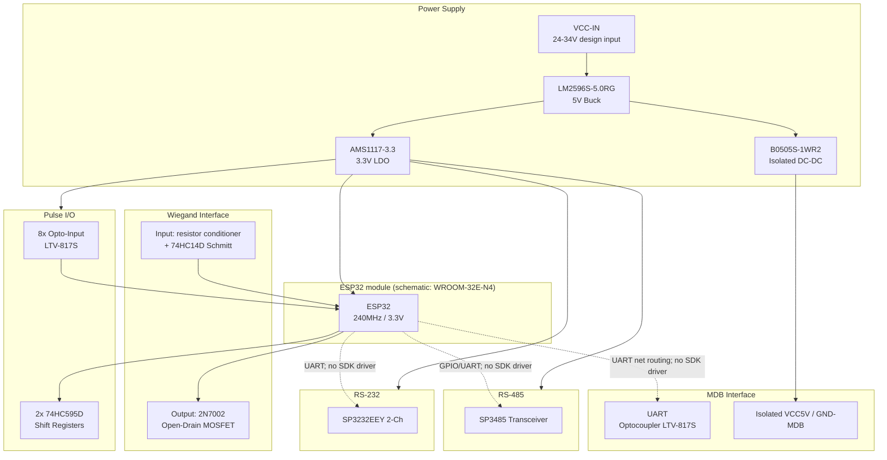

# VMC Buddy

**ESP32 vending-machine interface hardware and Arduino SDK**

VMC Buddy is an ESP32-based interface board for vending machines and payment systems. Its PCB provides isolated MDB circuitry, Wiegand I/O, RS-485/RS-232 transceivers, optoisolated pulse I/O, onboard buttons, and LEDs. The current Arduino SDK implements pulse/LED/button functions only; serial and Wiegand protocol drivers are not present in `src/`.

---

## System Block Diagram



> **Galvanic isolation:** MDB signal circuitry uses B0505S-1WR2 (`MDB-VCC5V` / `GND-MDB`) and LTV-817S optocouplers. Connector and power routing are detailed in the [schematic-based hardware guide](./docs/hardware_interfaces.md).
>
> **Revision note:** Schematic names MDB mode jumpers U25/U26 (U32/U35 are optocouplers) and routes `RS485-TX-EN` to GPIO15. See [configuration](./docs/configuration_guide.md) and [hardware details](./docs/hardware_interfaces.md) before wiring.

---

## Feature Matrix

| Interface | Hardware | Electrical details | SDK support |
|-----------|----------|-------------------|-------------|
| **MDB** | Master / Slave routing via U25/U26 | Isolated signal domain (B0505S + LTV-817S) | None |
| **Wiegand In** | D0/D1 input | 5V-side input, 74HC14D-conditioned TTL | None |
| **Wiegand Out** | D0/D1 open-drain | 2N7002, SM05T1G-ES, external pull-up | None |
| **RS-485** | Half-duplex SP3485 | 3.3V logic, PSM712, 120Ω termination/bias | None |
| **RS-232** | 2 TX/RX channels | SP3232EEY charge pump; PESD15VL2BT | None |
| **Pulse In** | 8 optoisolated channels | LTV-817S, separate `VCC-PULSE-*` nets | Interrupt reader (source limitation noted) |
| **Pulse Out** | 8 shift-register paths | 74HC595D + LTV-817S | Timed pulse API |
| **Onboard Keys** | 6-button analog ladder | 3.3V ADC | Internal polling/events |
| **Onboard LEDs** | 6 shift-register-driven LEDs | 3.3V logic | Blink API |

---

## Repository Structure

```
lib-vmc-buddy/
├── README.md                          ← This file
├── LICENSE                            ← GPL-3.0
├── platformio.ini                     ← Root project config
├── library.json                       ← PlatformIO library manifest
├── schematic/                         ← Schematic exports (PNG)
│   ├── SCH_Schematic3_1-power_2026-10-15.png
│   ├── SCH_Schematic3_2-mcu_2026-10-15.png
│   ├── SCH_Schematic3_3-RS232-RS485-interface_2026-10-15.png
│   ├── SCH_Schematic3_4-pulse-interfaces_2026-10-15.png
│   ├── SCH_Schematic3_5-MDB-interface_2026-10-15.png
│   ├── SCH_Schematic3_6-Wiegand-interface_2026-10-15.png
│   └── SCH_Schematic3_7-misc-interfaces_2026-10-15.png
├── src/                               ← Library source
│   ├── VMCBuddy.h / VMCBuddy.cpp      ← Main public API
│   ├── Context.h                      ← Singleton runtime state
│   ├── EventHandler.h                 ← Event bus (subscribe/trigger)
│   ├── IO.h                           ← Shift register & GPIO I/O
│   ├── PulseReader.h                  ← ISR-based pulse input
│   ├── PulseWriter.h                  ← Pulse output generator
│   ├── LedBlinker.h                   ← LED blink controller
│   ├── AnalogButtonReader.h           ← ADC button reader
│   └── macros.h                       ← All pin definitions & constants
├── examples/
│   ├── pulse-out/                     ← Pulse output + LED toggle
│   ├── onboard-led/                   ← LED walk test
│   └── onboard-keys/                  ← Button event demo
└── docs/
    ├── hardware_interfaces.md         ← Per-interface pinouts & operation
    ├── configuration_guide.md         ← Jumper settings & modes
    └── sdk_api_reference.md           ← Full API reference
```

`images/` is currently empty; no PCB layout or board-photo images are committed. The seven PNG schematic sheets in `schematic/` are the available hardware drawings and are linked from the docs.

---

## Quickstart

### Prerequisites

- [PlatformIO IDE](https://platformio.org/) (VS Code extension recommended) or PlatformIO Core CLI
- ESP32 board supported by PlatformIO `esp32dev`; schematic identifies U29 as ESP32-WROOM-32E-N4, while `library.json` names ESP32-WROOM-32D-H4
- USB-to-UART cable for flashing and serial monitor

### Build & Upload

```bash
# Clone the repository
git clone https://github.com/bedomarci/lib-vmc-buddy
cd lib-vmc-buddy

# Build and upload to ESP32
pio run --target upload

# Open serial monitor
pio device monitor --baud 115200
```

### Minimal Example

```cpp
#include <Arduino.h>
#include <TaskScheduler.h>
#include <VMCBuddy.h>

Scheduler scheduler;
VMCBuddy::VMCBuddy board(&scheduler);

void setup() {
    Serial.begin(115200);
    board.begin();          // Initialize all I/O, start tasks
}

void loop() {
    scheduler.execute();    // Run the cooperative scheduler
}
```

### Key APIs at a Glance

```cpp
// Implemented SDK pulse output
board.pinModePulse(7, OUTPUT);
board.sendPulse(7, 3, 500, 200);           // 3 pulses, 500ms on, 200ms off

// Implemented SDK LED blink
board.blink(0, 5, 300, 100);               // LED #1, 5 blinks
```

`setOnEventCallback()` and `digitalWritePulsePin()` are declared but not implemented. Pulse interrupt setup has an uninitialized mode-state issue; see [SDK limitations](./docs/sdk_api_reference.md#current-source-limitations).

---

## Dependencies

| Library | Version | Purpose |
|---------|---------|---------|
| [arkhipenko/TaskScheduler](https://github.com/arkhipenko/TaskScheduler) | ^3.3.0 | Cooperative task scheduling |
| [thijse/ArduinoLog](https://github.com/thijse/ArduinoLog) | ^1.1.1 | Logging framework |

---

## Documentation

- [Hardware Interfaces](./docs/hardware_interfaces.md) — Pinouts, electrical operation, protection circuitry
- [Configuration Guide](./docs/configuration_guide.md) — Solder jumpers, master/slave setup, practical examples
- [SDK API Reference](./docs/sdk_api_reference.md) — Full class hierarchy, method signatures, code examples

---

## License

GPL-3.0 — see [LICENSE](./LICENSE).

## Author

Bedő Marci — bedomarci@gmail.com
