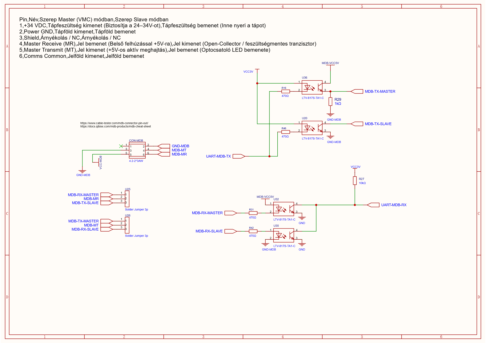

# MDB Interface

The MDB hardware provides isolated signal paths and jumper-selectable master/slave routing. The SDK provides a GPIO bit-bang 9-bit driver and an MDB peripheral layer; see [SDK API Reference](./sdk_api_reference.md).

## Hardware

An isolated DC-DC converter generates `MDB-VCC5V` (isolated 5 V, referenced to `GND-MDB`) from the board's `VCC5V` rail. The raw MDB bus voltage (24–34 V DC) enters through the connector as `VCC-MDB` and is a separate net. Optocouplers provide separate master and slave transmit paths and separate receive paths. The MDB mode solder jumpers select which paths reach the connector; use the [jumper configuration guide](./jumper_configuration.md#mdb-mode-solder-jumpers).

The schematic annotation describes a 24–34 V DC MDB supply; it does not specify a current rating.

MDB/ICP device behavior remains application-specific. The SDK supplies the bit-bang framing, packet checksum, and peripheral callback layers; applications must implement the device-specific MDB state and responses.

## MDB connector

The six-pin connector follows the pin roles documented on the production schematic:

| Pin | Signal | Master role | Slave role |
|---:|---|---|---|
| 1 | +34 V DC | Supply output to bus | Supply input |
| 2 | Power GND | Power return | Power return |
| 3 | Shield / NC | Shield or not connected | Shield or not connected |
| 4 | MDB-MR | Master receive input | Slave transmit output |
| 5 | MDB-MT | Master transmit output | Slave receive input |
| 6 | Comms Common | Communication reference | Communication reference |

Confirm pin-1 orientation against the connector marking before wiring.

## Mode routing

| Mode | Receive-link pads | Transmit-link pads | Signal routing |
|---|---:|---:|---|
| Master | 1–2 | 1–2 | MR to master RX path; MT to master TX path |
| Slave | 2–3 | 2–3 | MR to slave TX path; MT to slave RX path |

Set both solder jumpers to the same mode. Their schematic references and pad net names are in [Jumper Configuration](./jumper_configuration.md#mdb-mode-solder-jumpers).

## UART and SDK boundary

UART2 is routed to the MDB receive/transmit nets through the 2×15 through-hole jumper field. The selected paths and exact header pins are listed in the [jumper map](./jumper_configuration.md#2x15-through-hole-jumper-field). Application firmware must configure UART framing and implement MDB timing and protocol behavior; those functions are not provided by the SDK.
