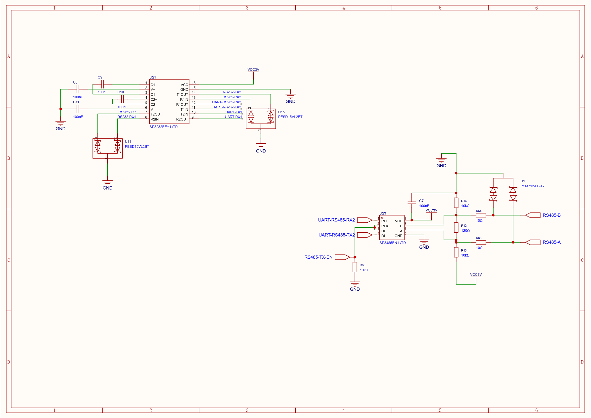

# RS-232 Interface

Two independent full-duplex RS-232 channels use one SP3232EEY transceiver with an integrated charge pump. The production schematic includes signal-line transient protection. The current SDK does not implement RS-232 UART configuration or protocol APIs; see [SDK API Reference](./sdk_api_reference.md).

## Electrical standard

RS-232 uses single-ended transmit and receive signals referenced to ground. The board transceiver translates between ESP32 logic and RS-232 line levels. Connector pin 3 is an auxiliary board supply, not an RS-232 signal; verify whether the connected device needs it before wiring.

## Connector pinouts

Each four-pin channel connector uses the same pin order:

| Pin | Signal | Direction at board |
|---:|---|---|
| 1 | RS232-TX | Output |
| 2 | RS232-RX | Input |
| 3 | Channel supply (`VCC-RS232-1` or `VCC-RS232-2`) | Supply |
| 4 | `GND` | Return |

## MCU routing

| Channel | TX GPIO | RX GPIO | UART2 header routing |
|---|---:|---:|---|
| 1 | 19 | 18 | Direct schematic nets |
| 2 | 17 | 16 | Selectable through the 2×15 jumper field |

The channel-2 UART2 links are listed in [Jumper Configuration](./jumper_configuration.md#2x15-through-hole-jumper-field). Connector supply routing is also selected there. Check the external device’s voltage and ground requirements before connecting it.
