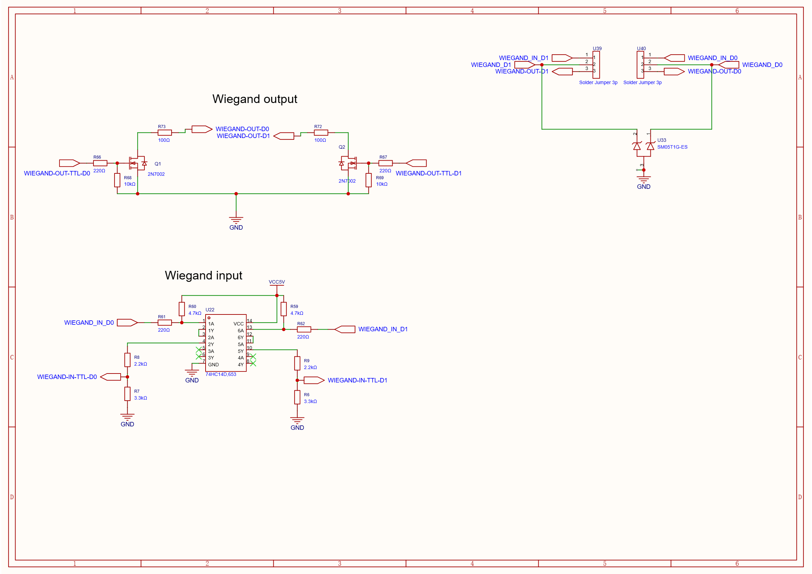

# Wiegand Interface

The board supports Wiegand reader input or open-drain D0/D1 output. Select one mode for both data lines using the [Wiegand mode solder jumpers](./jumper_configuration.md#wiegand-mode-solder-jumpers). The current SDK has no Wiegand API; see [SDK API Reference](./sdk_api_reference.md).

## Signal convention

Wiegand transfers data as active-low pulses on separate D0 and D1 lines. The interface circuit conditions or sinks these lines; firmware and the connected reader/controller determine frame format and pulse timing.

## Input circuit

External D0 and D1 pass through series resistance, 5 V pull-ups, and a 74HC14D Schmitt-trigger stage. Resistor dividers condition the outputs for the ESP32 input pins.

| Data line | ESP32 GPIO | MCU-side net |
|---|---:|---|
| D0 | 35 | `WIEGAND-IN-TTL-D0` |
| D1 | 34 | `WIEGAND-IN-TTL-D1` |

## Output circuit

Each output uses a 2N7002 MOSFET to pull its external data line low. The receiving equipment must provide the line pull-up. The schematic includes transient protection on the external lines.

| Data line | ESP32 GPIO control | TTL output net |
|---|---:|---|
| D0 | 23 | `WIEGAND-OUT-TTL-D0` |
| D1 | 22 | `WIEGAND-OUT-TTL-D1` |

TTL output nets are also exposed on the GPIO connector: pin 2 is D0 and pin 3 is D1. They are not pins on the Wiegand input connector.

## Wiegand input connector

| Pin | Signal |
|---:|---|
| 1 | `VCC5V` |
| 2 | Wiegand D1 |
| 3 | Wiegand D0 |
| 4 | `GND` |

The D0/D1 external lines are routed through the mode solder jumpers. Confirm connector orientation against the board marking. See [jumper pad mapping](./jumper_configuration.md#wiegand-mode-solder-jumpers).
