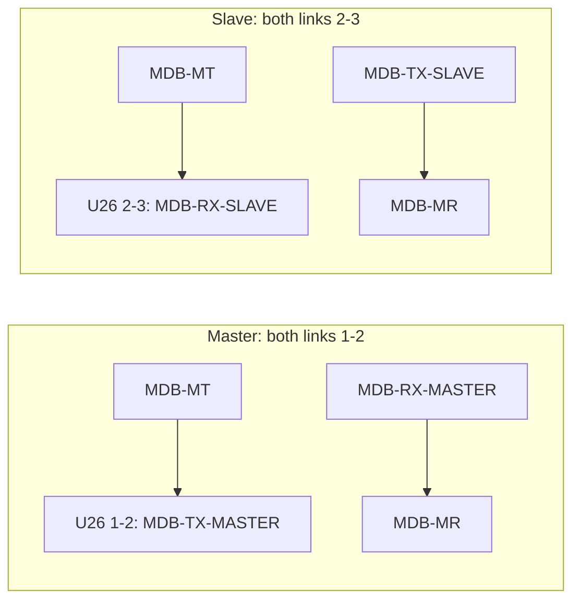

# Configuration Guide

Hardware configuration extracted from the schematic exports. Always disconnect power before soldering jumpers.

## MDB mode selection: U25 and U26

**Correction:** The MDB schematic labels **U25 and U26** as 3-pin solder jumpers. U32 and U35 are LTV-817S optocouplers, not jumpers. See [MDB schematic](../schematic/SCH_Schematic3_5-MDB-interface_2026-10-15.png).

Each 3-pad link has center pad 2. Bridge only the required pair on each link.

| Mode | U25 bridge | U26 bridge | Signal routing |
|------|------------|------------|----------------|
| Master | 1–2 | 1–2 | Master RX path uses MDB-MR; master TX path uses MDB-MT |
| Slave | 2–3 | 2–3 | Slave RX path uses MDB-MT; slave TX path uses MDB-MR |

| Jumper | Pad 1 | Center pad 2 | Pad 3 |
|--------|-------|--------------|-------|
| U25 | MDB-RX-MASTER | MDB-MR | MDB-TX-SLAVE |
| U26 | MDB-TX-MASTER | MDB-MT | MDB-RX-SLAVE |

The schematic selects each function through the midpoint. Set both links for the same role; do not bridge both outer positions simultaneously. The labels indicate signal routing only; MDB protocol operation and UART setup are not implemented by this SDK.

## Wiegand output selection: U39 and U40

The Wiegand sheet shows 3-pad solder jumpers U39/U40 for D1/D0 output routing between `WIEGAND-OUT-TTL-D1/D0` and the Wiegand lines. Confirm the desired pad pair from the board silkscreen and [Wiegand schematic](../schematic/SCH_Schematic3_6-Wiegand-interface_2026-10-15.png) before soldering. Do not treat them as software mode selectors.

## Pulse supply nets and connectors

The pulse sheet names separate nets `VCC-PULSE-1-RAW`, `VCC-PULSE-2-RAW`, and `VCC-PULSE-PULLUP`. The 30-pin U34 expansion header brings `VCC-PULSE-PULLUP` out on pins 15 and 17. No selectable internal/external pull-up jumper is identified in the committed schematic; use only the documented net and connector arrangement for your board revision.

Other relevant connectors from the drawings:

| Connector | Schematic use |
|-----------|---------------|
| `CON-PULSE-TERMINAL` | Pulse external channels 1–8, VCC-IN, GND |
| `CON-PULSE-1` / `CON-PULSE-2` | Two channel groups and raw pulse supply nets |
| `CON-RELAY` | VCC5V, channel 7/8 nets, GND |
| `U34` | 30-pin expansion header; see [hardware pinout](./hardware_interfaces.md#8-auxiliary-headers) |

## Practical setups

### Vending machine controller (MDB master)

1. Power off the board.
2. Bridge U25 pads 1–2 and U26 pads 1–2.
3. Connect the MDB cable according to the six-pin pinout in [Hardware Interfaces](./hardware_interfaces.md#1-mdb-multi-drop-bus-interface).
4. Configure the external firmware to use the master TX/RX routing and implement MDB framing/timing.

### Payment terminal (MDB slave)

1. Power off the board.
2. Bridge U25 pads 2–3 and U26 pads 2–3.
3. Connect the VMC on MT/MR and preserve the isolated MDB ground boundary.
4. Implement the MDB peripheral state machine and response timing in application firmware; current SDK does not provide it.

### Wiegand reader or output device

Use `CON-WIEGAND-IN` for external D0/D1 reader signals. For output, use the TTL output nets exposed through `CON-GPIO` and set U39/U40 hardware routing for the intended path. See schematic before changing the solder links.

## Power input

The power schematic labels the buck-converter input `VCC-IN`, output `VCC5V`, and LDO output `VCC3V`. It also shows DC1/CN1, `VCC-EXT-RAW`, D22, and `VCC-EXT`. The project design description specifies a 24–34V DC input; verify the exact board input connector and polarity against the PCB silkscreen. The schematic does not state current ratings, so none are specified here.

## Configuration boundaries

- Schematic exports do not mark factory-default solder bridges. Do not assume a default MDB mode.
- Firmware currently has no MDB, Wiegand, RS-232, or RS-485 setup API.
- ESP32 module marking differs across project metadata and schematic; see [Hardware Interfaces](./hardware_interfaces.md#10-esp32-mcu-pin-map).
