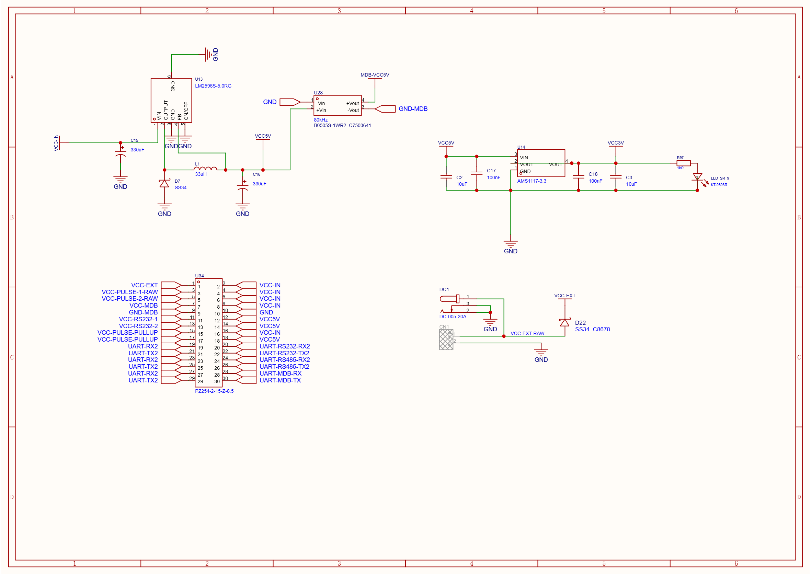
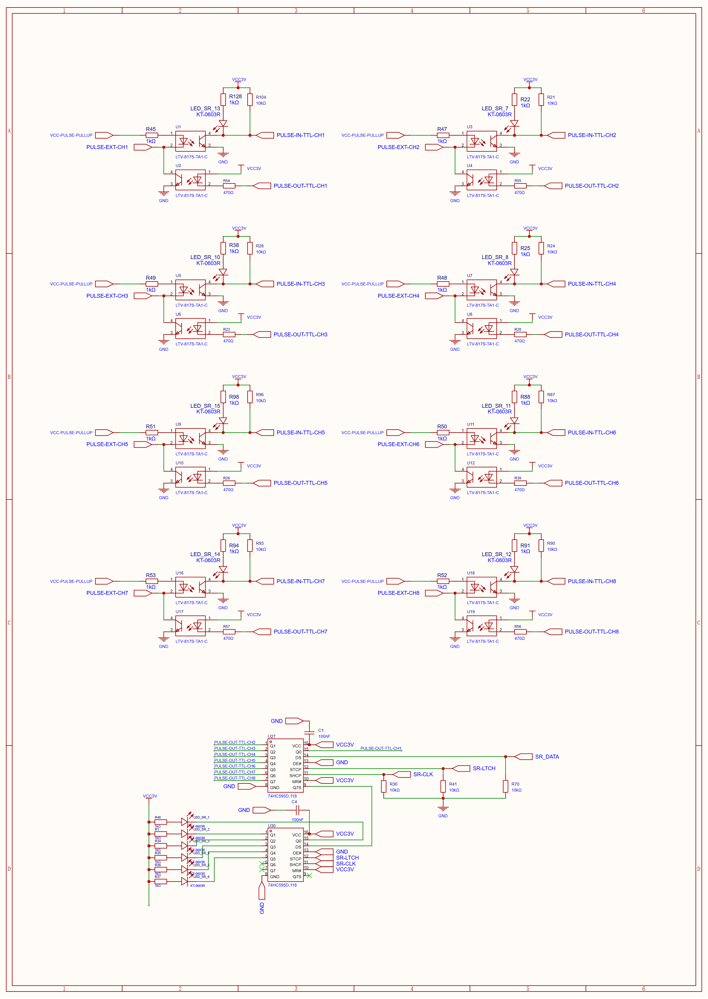
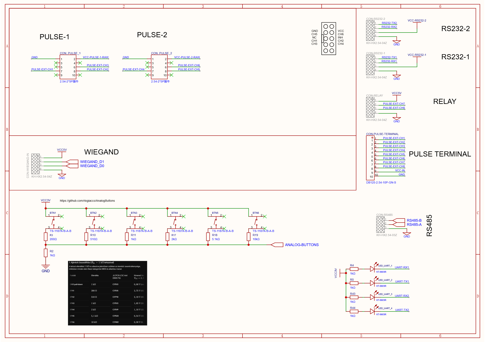
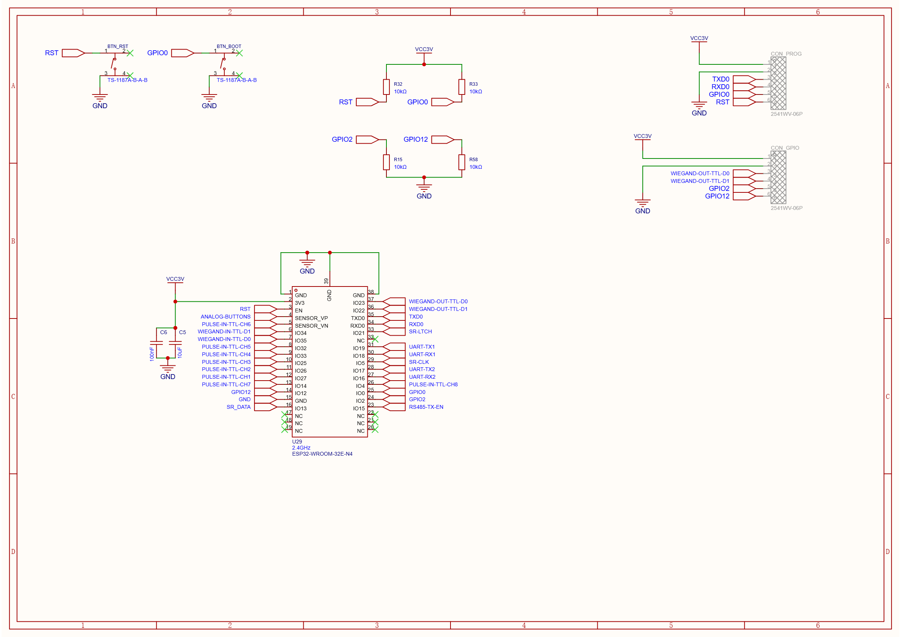

# Hardware Interfaces

Board-level overview based on the production [October 26, 2026 schematics](./README.md#schematic-sheets). Detailed interface circuitry and connector pinouts live in the linked interface documents; jumper settings are centralized in the [jumper configuration guide](./jumper_configuration.md).

## Interface index

| Interface | Board implementation | Details |
|---|---|---|
| MDB | Isolated power and optocoupler signal paths; master/slave routing | [MDB](./MDB.md) |
| Wiegand | Conditioned D0/D1 inputs and open-drain outputs | [Wiegand](./Wiegand.md) |
| RS-232 | Two full-duplex channels through a charge-pump transceiver | [RS-232](./RS232.md) |
| RS-485 | Half-duplex transceiver with fixed bus termination and bias | [RS-485](./RS485.md) |
| Pulse I/O | Eight optoisolated inputs and eight shift-register/opto output paths | [Pulse I/O](#pulse-io) |

The SDK currently implements pulse, LED, button, RS-232, RS-485, MDB, and command-interpreter functions. See [SDK API Reference](./sdk_api_reference.md) for full support status.

## Power

| Stage | Schematic function |
|---|---|
| Main buck converter | `VCC-IN` to `VCC5V` |
| 3.3 V regulator | `VCC5V` to `VCC3V` |
| Isolated DC-DC converter | `VCC5V` to `MDB-VCC5V` referenced to `GND-MDB` |
| External input | DC jack and terminal input feed `VCC-EXT` through the input protection path |

The through-hole jumper field can connect power nets; its complete map and isolation notes are in [Jumper Configuration](./jumper_configuration.md#2x15-through-hole-jumper-field). The schematic does not state current ratings. Do not infer them from the connector or regulator part numbers.

## Pulse I/O

Each input channel uses an optocoupler and has a corresponding MCU-side `PULSE-IN-TTL-CHx` signal. Each output path is driven from the 16-bit shift-register chain through an optocoupler. The raw pulse supplies and pull-up supply are separate nets; their routing is described in the [jumper guide](./jumper_configuration.md#2x15-through-hole-jumper-field).

### MCU pulse-input mapping

| Channel | ESP32 GPIO | MCU-side schematic net |
|---:|---:|---|
| 1 | 27 | `PULSE-IN-TTL-CH1` |
| 2 | 26 | `PULSE-IN-TTL-CH2` |
| 3 | 25 | `PULSE-IN-TTL-CH3` |
| 4 | 33 | `PULSE-IN-TTL-CH4` |
| 5 | 32 | `PULSE-IN-TTL-CH5` |
| 6 | 39 | `PULSE-IN-TTL-CH6` |
| 7 | 14 | `PULSE-IN-TTL-CH7` |
| 8 | 4 | `PULSE-IN-TTL-CH8` |

### External pulse connectors

The 10-pin `CON-PULSE-TERMINAL` maps pins 1–8 to external pulse channels 1–8, pin 9 to `VCC-IN`, and pin 10 to `GND`.

The two 10-pin group connectors split channels by group: connector 1 carries channels 1–3, connector 2 carries channels 4–6, and channels 7–8 are on CON-RELAY. Each group also exposes its dedicated raw supply net:

| Pin | Pulse group 1 | Pulse group 2 |
|---:|---|---|
| 1 | `GND` | `GND` |
| 2 | `VCC-PULSE-1-RAW` | `VCC-PULSE-2-RAW` |
| 4 | Channel 3 | Channel 6 |
| 6 | Channel 2 | Channel 5 |
| 8 | Channel 1 | Channel 4 |
| Other pins | NC | NC |

`CON-RELAY` is a four-pin connector: `VCC5V`, pulse channel 7, pulse channel 8, and `GND` on pins 1–4 respectively. The connector exposes these pulse nets; it does not add a separate relay driver.

### Shift-register outputs

| Shift-register bit | Function |
|---:|---|
| 15–8 | Pulse output paths 1–8, respectively |
| 7–2 | On-board LEDs 1–6, respectively |
| 1–0 | Unassigned in the SDK |

The MCU drives the two-cascaded 74HC595D chain by bit-banging data, clock, and latch signals; no hardware SPI peripheral is used. SDK APIs and timing units are documented in the [API reference](./sdk_api_reference.md).

## Auxiliary connectors

### Programming connector

Six pins: `VCC3V`, `TXD0`, `RXD0`, `GPIO0`, reset, and `GND` on pins 1–6 respectively.

### GPIO connector

Six pins: `VCC3V`, Wiegand D0 output TTL, Wiegand D1 output TTL, `GPIO2`, `GPIO12`, and `GND` on pins 1–6 respectively. See [Wiegand](./Wiegand.md) for signal direction and output circuit.

## ESP32 pin map

The table below covers application-level GPIOs. UART0 pins (TXD0, RXD0), GPIO0, GPIO2, and GPIO12 are accessible through the programming and GPIO connectors but are not listed here.

| GPIO | Board function |
|---:|---|
| 4 | Pulse input 8 |
| 5 | Shift-register clock |
| 13 | Shift-register data |
| 14 | Pulse input 7 |
| 15 | RS-485 direction control |
| 18 / 19 | RS-232 channel 1 TX / RX nets |
| 17 / 16 | RS-232 channel 2 TX / RX nets |
| 21 | Shift-register latch |
| 22 / 23 | Wiegand D1 / D0 output control |
| 25 / 26 / 27 | Pulse inputs 3 / 2 / 1 |
| 32 / 33 | Pulse inputs 5 / 4 |
| 34 / 35 | Wiegand D1 / D0 input |
| 36 | Analog button ladder |
| 39 | Pulse input 6 |

The schematic identifies the ESP32 module as WROOM-32E-N4. Consult the linked interface documents for full serial/UART signal routing and [jumper settings](./jumper_configuration.md).
