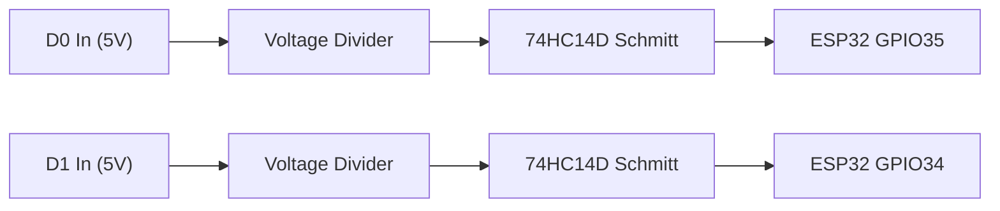
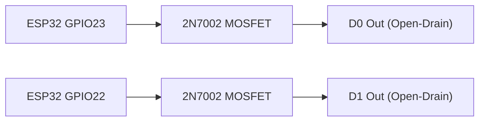
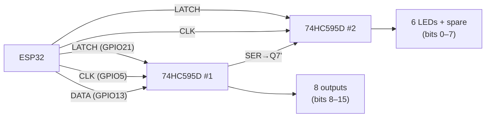

# Hardware Interfaces

Electrical operation and connector pinouts transcribed from the committed schematic exports. `images/` contains no PCB photos or layout screenshots; the seven schematic sheets are under `schematic/`.

> **Implementation boundary:** The PCB contains MDB, Wiegand, RS-485 and RS-232 circuits, but the current `src/` SDK does not implement protocol APIs for them. See [SDK API Reference](./sdk_api_reference.md).

---

## 1. MDB (Multi-Drop Bus) Interface

MDB is the primary protocol for communication between a vending machine controller (VMC) and peripheral devices (coin changers, bill validators, cashless payment terminals).


### Key Features

- **Galvanic isolation** — fully isolated from main circuit via B0505S-1WR2 DC-DC converter and LTV-817S optocouplers
- **Master/Slave mode** — jumper-selectable via U25 and U26 solder bridges
- **MDB signal domain:** Isolated optocoupler circuitry uses `MDB-VCC5V` and `GND-MDB`, generated through B0505S-1WR2

### Isolation Architecture

```
ESP32 (3.3V domain)                         MDB Bus (isolated 5V domain)
┌──────────────────┐                       ┌──────────────────────────┐
│  UART_MDB_TX ────┼──[LTV-817S opto]──────┼── MT (Master Transmit)   │
│  UART_MDB_RX ────┼──[LTV-817S opto]──────┼── MR (Master Receive)    │
│                  │                       │                          │
│     VCC3V        │   B0505S-1WR2         │      MDB-VCC5V           │
│     GND          │   (isolated DC-DC)    │      GND-MDB             │
└──────────────────┘                       └──────────────────────────┘
```

### MDB connector (`CON-MDB`, 6 pins)

The sheet's connector note documents the standard harness pin roles below. Confirm connector orientation against the board before wiring.

| Pin | Signal | Direction (Master) | Direction (Slave) | Description |
|-----|--------|-------------------|-------------------|-------------|
| 1 | +34V | Supply input | Supply input | MDB power input, nominally up to 34V |
| 2 | Power GND | Return | Return | Power ground |
| 3 | Shield / NC | Shield / NC | Shield / NC | Chassis shield, otherwise NC |
| 4 | MR (Master Receive) | Input | Output | Master receives; slave response line. Open-collector/optocoupled circuit |
| 5 | MT (Master Transmit) | Output | Input | Master transmits; slave receives through optocoupler input |
| 6 | Comms Common | Common | Common | MDB communication reference |

### UART Signal Mapping

The schematic routes `UART-MDB-TX` / `UART-MDB-RX` through optocouplers and U25/U26 routing jumpers. It does not define UART framing, baud rate, or a firmware driver; application firmware must implement the required MDB timing/framing.

| Internal Net | ESP32 UART | Jumper routing |
|-------------|------------|------------------------|
| `UART-MDB-TX` | ESP32 UART TX net | Routed to master TX or slave TX optocoupler path by U26 |
| `UART-MDB-RX` | ESP32 UART RX net | Routed from master RX or slave RX optocoupler path by U25 |

### Master/Slave Jumper Configuration

Refer to [Configuration Guide](./configuration_guide.md) for U25/U26 solder-bridge settings. **U32 and U35 are LTV-817S optocouplers, not jumpers.**

---

## 2. Wiegand Interface

Wiegand is used for access control card readers and vending machine cashless payment terminals. The interface consists of two data lines (D0 and D1) carrying card identification data.


### Key Features

- **Wiegand Input:** 5V pull-up / resistor conditioning and 74HC14D Schmitt-trigger buffer; logic nets `WIEGAND-IN-TTL-D0/D1`
- **Wiegand Output:** 2N7002 open-drain MOSFETs Q1/Q2; SM05T1G-ES protection U33
- **Output selection:** 3-pad solder links U39/U40 select the Wiegand/TTL signal path

### Wiegand Input (Reader Mode)



The input network uses 4.7kΩ series/pull-up components, 2.2kΩ/3.3kΩ conditioning resistors, and a 74HC14D Schmitt trigger. The schematic labels the MCU-side outputs `WIEGAND-IN-TTL-D0/D1`; no SDK Wiegand reader API is currently provided.

### Wiegand Output (Card Emulation Mode)



The 2N7002 sinks the selected line; external pull-up is supplied by the receiving equipment. U33 (SM05T1G-ES) protects the external lines. U39/U40 are 3-pin solder jumpers between the TTL and Wiegand nets; check the board's silkscreen and schematic before soldering.

### Wiegand input connector (`CON-WIEGAND-IN`, 4 pins)

| Pin | Signal | ESP32 GPIO | Direction | Level | Protection |
|-----|--------|-----------|-----------|-------|------------|
| 1 | VCC5V | — | Supply out | 5V | — |
| 2 | WIEGAND_D1 | GPIO34 via input conditioner | Input | 5V-side input | 74HC14D |
| 3 | WIEGAND_D0 | GPIO35 via input conditioner | Input | 5V-side input | 74HC14D |
| 4 | GND | — | Return | 0V | — |

Output nets `WIEGAND-OUT-TTL-D0/D1` are available on the 6-pin `CON-GPIO` header and routed through Q1/Q2 and U39/U40 to the Wiegand output nets. They are not pins 3/4 of `CON-WIEGAND-IN`.

---

## 3. RS-485 Interface

Half-duplex RS-485 for industrial multi-drop communication (Modbus RTU, proprietary protocols).


### Key Features

- **Transceiver:** SP3485 (3.3V supply, up to 10 Mbps)
- **Direction control:** Schematic connects `RS485-TX-EN` to ESP32 GPIO15 (module U29 pin 23), with R63 10kΩ pull-down. This differs from the earlier GPIO2 description and should be checked against the assembled PCB revision.
- **Fail-safe bias:** R13 (10kΩ pull-up to 3.3V on A), R14 (10kΩ pull-down to GND on B) — ensures deterministic idle state when bus is undriven
- **Termination:** 120Ω on-board termination resistor (R12)
- **ESD protection:** PSM712 dual TVS diode array

### Signal Flow

```mermaid
graph LR
    ESP_TX["ESP32 UART TX"] --> DI["SP3485 DI"]
    ESP_RX["ESP32 UART RX"] <-- RO["SP3485 RO"]
    GPIO15["ESP32 GPIO15"] --> DEN["DE / RE"]
    DI --> A["A (+)"]
    DI --> B["B (-)"]
    A --> RO
    B --> RO
```

| Net | ESP32 Pin | SP3485 Pin | Description |
|-----|-----------|------------|-------------|
| RS485-TX | UART TX | DI (pin 4) | Data input to transceiver |
| RS485-RX | UART RX | RO (pin 1) | Data output from transceiver |
| RS485-TX-EN | GPIO15 per schematic | DE (pin 3) + /RE (pin 2) | Half-duplex direction control; verify polarity/revision |

### RS-485 connector (`CON-RS485`, 3 pins)

| Pin | Signal | Description |
|-----|--------|-------------|
| 1 | RS485-B | Differential bus line B |
| 2 | RS485-A | Differential bus line A |
| 3 | GND | Signal reference |

### Direction Control

```cpp
// Schematic net RS485-TX-EN is on GPIO15 (verify PCB revision).
void rs485SetTransmit(bool tx) {
    digitalWrite(15, tx ? HIGH : LOW);
}
```

R63 pulls the direction-control net down. RS-485 communication is not implemented by the current VMCBuddy SDK.

---

## 4. RS-232 Interface

Two independent full-duplex RS-232 channels with standard ±RS-232 voltage levels.


### Key Features

- **Transceiver:** SP3232EEY (3.3V supply, integrated charge pump generates ±RS-232 levels)
- **2 independent channels:** TX1/RX1 and TX2/RX2
- **ESD protection:** PESD15VL2BT dual TVS on each signal line

### RS-232 connectors (`CON-RS232-1`, `CON-RS232-2`, 4 pins each)

**Channel 1**

| Pin | Signal | Direction | Description |
|-----|--------|-----------|-------------|
| 1 | RS232-TX1 | Output | Transmit |
| 2 | RS232-RX1 | Input | Receive |
| 3 | VCC-RS232-1 | Supply | Connector supply net |
| 4 | GND | Return | Ground |

**Channel 2**

| Pin | Signal | Direction | Description |
|-----|--------|-----------|-------------|
| 1 | RS232-TX2 | Output | Transmit |
| 2 | RS232-RX2 | Input | Receive |
| 3 | VCC-RS232-2 | Supply | Connector supply net |
| 4 | GND | Return | Ground |

The MCU sheet routes UART-TX1/RX1 to GPIO19/GPIO18 and UART-TX2/RX2 to GPIO17/GPIO16. These are schematic net mappings, not SDK-configured UART objects. U21 is SP3232EEY-L/TR; U15 and U38 are PESD15VL2BT protection devices.

---

## 5. Pulse I/O Interface

Eight configurable pulse channels. Each can be independently set as input (optoisolated) or output (shift register + optocoupler-driven).


### Architecture

```
                    ┌── Pulse 1 ── LTV-817S ── GPIO27 ──┐
                    │  Pulse 2 ── LTV-817S ── GPIO26    │
Pulse Inputs (8×)   │  ...                               │── ESP32 GPIO
(Optoisolated)      │  ...                               │
                    └── Pulse 8 ── LTV-817S ── GPIO4  ──┘

                    ┌── SR bit 15 ── 74HC595D ── opto ── Pulse Out 1
Pulse Outputs (8×)  │  SR bit 14 ── 74HC595D ── opto ── Pulse Out 2
(Shift Register)    │  ...                                    ...
                    │  SR bit  8 ── 74HC595D ── opto ── Pulse Out 8
                    │  SR bit  9 ── 74HC595D ── Relay 1
                    │  SR bit  8 ── 74HC595D ── Relay 2
                    └── 74HC595D chain (16-bit, 3.3V) ── [ESP32 SPI-like GPIO bit-bang]
```

### MCU pulse-input mapping

| Channel | External net | ESP32 GPIO | Schematic input indicator |
|---------|--------------|-----------|---------------------------|
| 1 | PULSE-EXT-CH1 | GPIO27 | LED_SR_13 |
| 2 | PULSE-EXT-CH2 | GPIO26 | LED_SR_7 |
| 3 | PULSE-EXT-CH3 | GPIO25 | LED_SR_10 |
| 4 | PULSE-EXT-CH4 | GPIO33 | LED_SR_8 |
| 5 | PULSE-EXT-CH5 | GPIO32 | LED_SR_15 |
| 6 | PULSE-EXT-CH6 | GPIO39 | LED_SR_11 |
| 7 | PULSE-EXT-CH7 | GPIO14 | LED_SR_14 |
| 8 | PULSE-EXT-CH8 | GPIO4 | LED_SR_12 |

Each channel uses an LTV-817S input optocoupler and a separate 3.3V-side LED indicator. The schematic shows 10kΩ pull-up resistors (including R87) and 1kΩ LED resistors; per-channel topology is in the sheet. `VCC-PULSE-PULLUP` and per-group `VCC-PULSE-1-RAW` / `VCC-PULSE-2-RAW` are distinct schematic supply nets; no undocumented jumper selection is assumed.

### Pulse connector pinouts

The 10-pin `CON-PULSE-TERMINAL` provides pulse input nets and power, not the MCU's eight shift-register output pins:

| Pin | Signal |
|-----|--------|
| 1–8 | `PULSE-EXT-CH1` … `PULSE-EXT-CH8` |
| 9 | `VCC-IN` |
| 10 | `GND` |

The schematic also has 10-pin `CON-PULSE-1` / `CON-PULSE-2` connectors for grouped channels and raw supply nets:

| Pin | `CON-PULSE-1` | `CON-PULSE-2` |
|-----|---------------|---------------|
| 1 | GND | GND |
| 2 | VCC-PULSE-1-RAW | VCC-PULSE-2-RAW |
| 3 | NC | NC |
| 4 | PULSE-EXT-CH3 | PULSE-EXT-CH6 |
| 5 | NC | NC |
| 6 | PULSE-EXT-CH2 | PULSE-EXT-CH5 |
| 7 | NC | NC |
| 8 | PULSE-EXT-CH1 | PULSE-EXT-CH4 |
| 9 | NC | NC |
| 10 | NC | NC |

`CON-RELAY` is a separate 4-pin connector: VCC5V, PULSE-EXT-CH7, PULSE-EXT-CH8, GND.

### Shift-register outputs

| Channel | SR Bit | Connector | Relay | Description |
|---------|--------|-----------|-------|-------------|
| Pulse Out 1 | 15 | `PULSE-OUT-TTL-CH1` path | — | 470Ω series resistor and LTV-817S |
| Pulse Out 2 | 14 | `PULSE-OUT-TTL-CH2` path | — | 470Ω series resistor and LTV-817S |
| Pulse Out 3 | 13 | `PULSE-OUT-TTL-CH3` path | — | 470Ω series resistor and LTV-817S |
| Pulse Out 4 | 12 | `PULSE-OUT-TTL-CH4` path | — | 470Ω series resistor and LTV-817S |
| Pulse Out 5 | 11 | `PULSE-OUT-TTL-CH5` path | — | 470Ω series resistor and LTV-817S |
| Pulse Out 6 | 10 | `PULSE-OUT-TTL-CH6` path | — | 470Ω series resistor and LTV-817S |
| Pulse Out 7 | 9 | `PULSE-OUT-TTL-CH7` path | Relay 1 alias in SDK | 470Ω series resistor and LTV-817S |
| Pulse Out 8 | 8 | `PULSE-OUT-TTL-CH8` path | Relay 2 alias in SDK | 470Ω series resistor and LTV-817S |

### Shift Register Chain



**Bit mapping (16-bit chain):**

| Bit | 15 | 14 | 13 | 12 | 11 | 10 | 9 | 8 | 7 | 6 | 5 | 4 | 3 | 2 | 1 | 0 |
|-----|----|----|----|----|----|----|---|---|---|---|---|---|---|---|---|---|
| Function | P1 | P2 | P3 | P4 | P5 | P6 | P7 | P8 | L1 | L2 | L3 | L4 | L5 | L6 | — | — |

I/O is bit-banged via GPIO — no SPI hardware used. See `IO::render()` in `IO.h`.

---

## 6. Onboard Buttons

Six pushbuttons on a single analog input via a resistor ladder.

| Button | Approx. ADC Value | Tolerance |
|--------|-------------------|-----------|
| BTN 1 | 3150 | ±80 |
| BTN 2 | 2880 | ±80 |
| BTN 3 | 2560 | ±80 |
| BTN 4 | 1820 | ±80 |
| BTN 5 | 1120 | ±80 |
| BTN 6 | 820 | ±80 |

Reading interval: 200 ms. Events: `BUTTON_PRESS` (param: button index 0–5), `BUTTON_RELEASE` (param: -1).

---

## 7. Onboard LEDs

Six LEDs driven by the shift register chain.

| LED | SR Bit |
|-----|--------|
| LED 1 | 7 |
| LED 2 | 6 |
| LED 3 | 5 |
| LED 4 | 4 |
| LED 5 | 3 |
| LED 6 | 2 |

---

## 8. Auxiliary headers


### `CON-PROG` (6 pins)

| Pin | Signal | Use |
|-----|--------|-----|
| 1 | VCC3V | 3.3V |
| 2 | TXD0 | UART0 transmit |
| 3 | RXD0 | UART0 receive |
| 4 | GPIO0 | Boot/program selection |
| 5 | RST | Reset |
| 6 | GND | Ground |

### `CON-GPIO` (6 pins)

| Pin | Signal | MCU mapping |
|-----|--------|-------------|
| 1 | VCC3V | 3.3V |
| 2 | WIEGAND-OUT-TTL-D0 | GPIO23 path |
| 3 | WIEGAND-OUT-TTL-D1 | GPIO22 path |
| 4 | GPIO2 | GPIO2 |
| 5 | GPIO12 | GPIO12 |
| 6 | GND | Ground |

### 30-pin expansion header (`U34`, PZ254-2-15-Z-8.5)

| Pin | Net | Pin | Net |
|-----|-----|-----|-----|
| 1 | VCC-EXT | 2 | VCC-IN |
| 3 | VCC-PULSE-1-RAW | 4 | VCC-IN |
| 5 | VCC-PULSE-2-RAW | 6 | VCC-IN |
| 7 | VCC-MDB | 8 | VCC-IN |
| 9 | GND-MDB | 10 | GND |
| 11 | VCC-RS232-1 | 12 | VCC5V |
| 13 | VCC-RS232-2 | 14 | VCC5V |
| 15 | VCC-PULSE-PULLUP | 16 | VCC-IN |
| 17 | VCC-PULSE-PULLUP | 18 | VCC5V |
| 19 | UART-RX2 | 20 | UART-RS232-RX2 |
| 21 | UART-TX2 | 22 | UART-RS232-TX2 |
| 23 | UART-RX2 | 24 | UART-RS485-RX2 |
| 25 | UART-TX2 | 26 | UART-RS485-TX2 |
| 27 | UART-RX2 | 28 | UART-MDB-RX |
| 29 | UART-TX2 | 30 | UART-MDB-TX |

Net labels transcribed from sheet 7. Verify header pin 1/orientation from PCB silkscreen before connecting.

---

## 9. Power Supply


| Stage | Component | Input | Output | Purpose |
|-------|-----------|-------|--------|---------|
| 1 | LM2596S-5.0RG | VCC-IN | 5.0V (`VCC5V`) | Main buck converter |
| 2 | AMS1117-3.3 | 5.0V | 3.3V | MCU and peripheral LDO |
| 3 | B0505S-1WR2 | VCC5V | 5.0V isolated (`MDB-VCC5V`, `GND-MDB`) | Isolated MDB-side supply |

The schematic also shows DC jack `DC1` and input connector `CN1`, a Schottky diode D22 (SS34_C678), and nets `VCC-EXT-RAW` / `VCC-EXT`. The drawing does not specify current ratings. Keep the isolated `GND-MDB` distinct from system `GND`.

---

## 10. ESP32 MCU Pin Map


| GPIO | Function | Net Name |
|------|----------|----------|
| 15 | RS-485 direction control | RS485-TX-EN |
| 4 | Pulse input 8 | PULSE_IN8 |
| 5 | Shift register clock | SR-CLK |
| 13 | Shift register data | SR-DATA |
| 14 | Pulse input 7 | PULSE_IN7 |
| 21 | Shift register latch | SR-LTCH |
| 22 | Wiegand D1 output | WG_D1_OUT |
| 23 | Wiegand D0 output | WG_D0_OUT |
| 25 | Pulse input 3 | PULSE_IN3 |
| 26 | Pulse input 2 | PULSE_IN2 |
| 27 | Pulse input 1 | PULSE_IN1 |
| 32 | Pulse input 5 | PULSE_IN5 |
| 33 | Pulse input 4 | PULSE_IN4 |
| 34 | Wiegand D1 input | WG_D1_IN |
| 35 | Wiegand D0 input | WG_D0_IN |
| 36 | Analog button ladder | ANALOG_BTNS (ADC1_CH0) |
| 39 | Pulse input 6 | PULSE_IN6 |

The MCU sheet identifies module U29 as **ESP32-WROOM-32E-N4**. `library.json` describes ESP32-WROOM-32D-H4 and PlatformIO selects generic `esp32dev`; confirm the fitted module/revision before relying on module-specific details.
